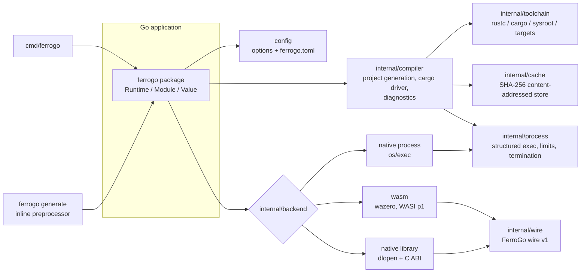

# FerroGo Architecture

Status: design baseline for v0.x. Implementation status per phase lives in
[roadmap.md](roadmap.md). The cross-language ABI is specified separately in
[abi.md](abi.md).

## 1. Goals and non-goals

FerroGo lets Go programs compile Rust source and then run it, either as a
program (`fn main`) or as a module whose exported functions are called many
times. It hides compiler invocation, temporary projects, artifact caching,
process management and memory marshalling behind one Go API and one CLI.

Non-goals:

* FerroGo is not a Rust compiler. It drives the user's `rustc`/`cargo`.
* FerroGo does not do machine-code JIT compilation. Everything is compiled
  ahead of time (AOT) by `rustc`/LLVM and then loaded on demand: WASM
  modules are instantiated in wazero, native libraries are opened with `dlopen`.
  "JIT-style" in this document only means "compile once at runtime, call
  many times".
* FerroGo does not make ordinary `go build` understand Rust syntax. Inline
  Rust is handled by a generator (`ferrogo generate`) that runs before
  `go build`, much like `protoc` or `stringer`.

## 2. Component overview



Request flow for `Runtime.Run`:

1. Resolve the source (`Code`, `File`, `Project`) into a canonical source set.
2. Resolve the backend (`auto` → `wasm`, see §6) and check that the trust
   policy permits it.
3. Resolve the target triple for the backend and artifact kind.
4. Detect the toolchain lazily, once per `Runtime`, and check that the target
   is installed.
5. Compute the cache key (§8). On a hit, return the cached artifact.
6. On a miss, generate a Cargo project in a private work directory, run
   `cargo build --message-format=json` with structured arguments and a
   scrubbed environment, parse the diagnostics, and move the artifact
   atomically into the cache.
7. Hand the artifact to the backend, which executes it with the configured
   limits and returns a structured `Result`.

`Runtime.Compile` follows the same path with a library artifact (`cdylib`)
and returns a `Module` that stays loaded until `Close`.

## 3. Package layout

```text
github.com/alirezahematidev/ferrogo
├── *.go                 public API (package ferrogo)
├── cmd/ferrogo/          CLI
├── internal/
│   ├── toolchain/       rustc/cargo/rustup discovery, sysroot target checks
│   ├── compiler/        Cargo project generation, cargo driver, diagnostics
│   ├── cache/           content-addressed artifact store, keys, atomic writes
│   ├── process/         safe process execution, output limits, termination
│   ├── backend/         backend interface + native/, wasm/, dylib/
│   ├── abi/             Rust-side ABI helper (ferrogo.rs, embedded into library builds)
│   └── wire/            FerroGo wire v1 codec (Go side)
├── examples/            one runnable program per feature
├── testdata/            fixtures
└── docs/
```

This departs from the suggested `pkg/ferrogo/...` tree on purpose. In Go, the
module root is the conventional home for the primary package
(`import "github.com/alirezahematidev/ferrogo"`). Everything that does not need
to be public lives in `internal/` so it can change without breaking users.
A package is promoted out of `internal/` only when there is a concrete
external use for it.

## 4. Engineering decisions

### 4.1 Default WASI target: `wasm32-wasip1`

* `wasm32-wasip1` (formerly `wasm32-wasi`, renamed in Rust 1.78) is a Tier 2
  Rust target. It is the only WASI target wazero implements
  (`wasi_snapshot_preview1`).
* `wasm32-wasip2` needs the Component Model, which wazero does not support.
  It is rejected.
* `wasm32-unknown-unknown` can be selected for modules that need no host I/O.
  These modules import nothing, so they are the most restricted option.
  `std` I/O on this target is unsupported: `println!` output is discarded and
  file or clock access fails.
* `wasm32-wasip1-threads` is not supported. wazero's threads support is
  experimental.

### 4.2 Required wazero APIs (v1.12)

| Need | wazero API |
| --- | --- |
| runtime with limits | `NewRuntimeWithConfig`, `RuntimeConfig.WithMemoryLimitPages`, `WithCloseOnContextDone(true)` |
| compiled-code cache | `NewCompilationCacheWithDir`, `RuntimeConfig.WithCompilationCache` |
| compile once, instantiate many | `Runtime.CompileModule`, `Runtime.InstantiateModule` |
| WASI | `imports/wasi_snapshot_preview1.Instantiate` |
| capabilities | `ModuleConfig.WithStdin/Stdout/Stderr`, `WithEnv`, `WithArgs`, `WithFSConfig` (`NewFSConfig().WithReadOnlyDirMount/WithDirMount`), `WithSysWalltime`, `WithSysNanotime`, `WithRandSource`, `WithStartFunctions` |
| host functions | `Runtime.NewHostModuleBuilder` |
| calls and memory | `api.Module.ExportedFunction`, `api.Function.Call`, `api.Memory.Read/Write` |
| exit codes | `sys.ExitError` |

`WithCloseOnContextDone` is what makes timeouts and cancellation interrupt
infinite loops inside guest code. Its cost was measured at 8.7× on
call-heavy code; see [performance.md](performance.md).

`Run` creates a fresh wazero runtime per execution, because the memory
limit is a runtime-level setting, and shares one file-backed
`CompilationCache`. Measured overhead is 0.75 ms per warm run, so pooling
compiled modules is unnecessary for programs. Modules (Phase 4) keep their
runtime and compiled module for their lifetime.

WASI sleeps use a context-aware `Nanosleep`, and stdin is wrapped in a
context-aware reader. Without these, a sleeping or blocked guest would
outlive its timeout, because wazero cannot interrupt host functions.

### 4.3 Function exports across backends

Rust functions are exported with the `ferrogo::export!` macro. It is a plain
`macro_rules!` macro shipped as a single Rust source file that FerroGo injects
into generated crates, so it needs no crates.io dependency and works offline.
For each function `f` the macro emits:

* `f` itself, as normal Rust.
* `ferrogo_v1_call_f`: a C-ABI entry point using the envelope calling
  convention (§4.4). Its signature is identical on every backend.
* `ferrogo_v1_sig_f`: returns the Rust signature as text, for `Inspect` and
  for ABI-mismatch diagnostics.

Prototype verified on rustc 1.94: `#[unsafe(export_name = concat!(...))]`
works in editions 2021 and 2024, on `aarch64-apple-darwin` (cdylib) and on
`wasm32-wasip1`.

Plain `#[no_mangle] pub extern "C" fn` exports are also callable ("raw C
convention"), with these restrictions:

* WASM: scalar types only. The signature is read from the module's export
  type section, so `i32` and `u32` are indistinguishable and both come back as
  `Int32`.
* Native library: the caller must declare the signature. A symbol table
  carries no type information, and calling a function through the wrong
  signature is undefined behavior.

### 4.4 Typed call ABI: one envelope, tagged values

Every `ferrogo::export!` function is reached through the same machine-level
signature:

```c
uint32_t ferrogo_v1_call_<name>(const uint8_t *in, size_t in_len, fg_buf *out);
```

Arguments are encoded as a tagged, little-endian value list (FerroGo wire v1).
The function decodes them, calls the user function, catches panics where the
target supports unwinding, and writes an owned, encoded result to `*out`.
Go copies the result and returns it through `ferrogo_free`. The status code
distinguishes ok, error (`Result::Err`), panic, and ABI mismatch.

Consequences:

* Go needs no per-function machine signature. One trampoline type serves
  every call on every backend, and a wrong argument type becomes a clean
  `ErrABIMismatch` instead of undefined behavior.
* Native calls pass only pointers and integers. Pure-Go FFI
  (`purego.SyscallN`, `syscall.SyscallN`) is therefore correct here: there are
  no float-register or struct-return classification issues.
* The cost is one encode and one decode per call: about 1 µs on WASM and
  0.7 µs on a native library. Plain `extern "C"` scalar exports can skip it
  (raw calls: 0.55 µs on WASM).

Full specification: [abi.md](abi.md).

### 4.5 Native dynamic library loading

| Platform | Load | Lookup | Call | Unload |
| --- | --- | --- | --- | --- |
| Linux (amd64, arm64) | `purego.Dlopen(RTLD_NOW\|RTLD_LOCAL)` | `purego.Dlsym` | `purego.SyscallN` | `purego.Dlclose` |
| macOS (amd64, arm64) | same | same | same | same (often a no-op for Rust dylibs with TLS destructors) |
| Windows (amd64, arm64) | `syscall.LoadDLL` (absolute path) | `FindProc` | `syscall.SyscallN` | `FreeLibrary` |

purego is chosen over cgo for three reasons:

1. `CGO_ENABLED=0` builds and cross-compilation keep working for users who
   only use WASM.
2. The envelope ABI needs only integer and pointer arguments, which is
   purego's best-supported subset.
3. It is actively maintained (ebitengine) and used in production.

Go memory passed to Rust is pinned with `runtime.Pinner` for the duration of
the call and must not be retained by Rust. That rule is documented in
[abi.md](abi.md). If a platform cannot use purego, a cgo bridge (one C
trampoline of the same signature) can be added behind a build tag without
changing the public API.

### 4.6 Inline Rust and Go tooling

Go source files must stay valid Go, or `gopls`, `go vet` and `go build`
break. Implemented design:

* **Preferred: cgo-style comment blocks.** Rust lives in a
  `/*ferrogo ... */` block comment in a `.go` file, next to a
  `//go:generate ferrogo generate` directive. The file remains valid Go.
* **Alternative: sibling Rust files.** Files named `*.ferrogo.rs` in the
  package directory are included too, and rust-analyzer can open those.
* Top-level `pub fn` items are exported automatically. They are wrapped in
  `ferrogo::export!` on the same lines, so line numbers are preserved.
* `ferrogo generate` extracts the Rust code, records a source map (Go file and
  line for every Rust line), and compiles it. It then writes:
  * `ferrogo_generated.go`, with typed Go wrappers
    (`func Calculate(ctx, a, b int32) (int32, error)`) generated from the
    compiled module's real signatures;
  * `ferrogo_generated.wasm`, embedded with `//go:embed`.

  The output is deterministic (fixed flags, `--remap-path-prefix`, sorted
  output) and starts with `// Code generated by ferrogo generate; DO NOT EDIT.`
  `generate -check` verifies freshness without a toolchain. See
  [inline-rust.md](inline-rust.md).
* Compiler diagnostics are re-mapped through the source map to the original
  `.go` file and line.
* **Rejected: a mixed-syntax `.rsgo` file.** It defeats both `gopls` and
  rust-analyzer. It could be added later as a thin front end to the same
  generator, but it is not the recommended workflow.
* The runtime string API (`ferrogo.Code`) works without any generator.

Because the generator embeds prebuilt artifacts, end users of an application
that uses inline Rust do **not** need a Rust toolchain. Only developers do.

### 4.7 Safe artifact caching

* Content-addressed by SHA-256 over a canonical, length-prefixed encoding of
  every input that can change the artifact (§8.1).
* Artifacts are written to a temporary file in the same directory tree,
  fsynced, made read-only, and then `rename`d into place. Readers never see
  partial artifacts.
* In-process duplicate builds are coalesced with a keyed single-flight.
  Concurrent processes may both build the same key; the second rename loses
  harmlessly. This avoids cross-platform file locking.
* Cache entries carry a metadata file with the full fingerprint. If the
  fingerprint does not match on read, the entry is treated as a miss.

### 4.8 Isolating untrusted code

Rust source must be treated as hostile **at compile time as well as at run
time**:

* `include_str!` and `include_bytes!` can read any file the compiler can
  read and embed it in the artifact. `env!` can read the compiler's
  environment.
* Dependencies run arbitrary code through `build.rs` and proc-macros.

Mitigations:

* The compiler runs with an allowlisted environment.
* Dependencies are denied unless a dependency policy allows them.
* Network access for dependency fetching requires an explicit opt-in.
* The compile timeout is enforced.
* `WithCompilerSandbox(true)` runs the whole toolchain under the OS sandbox
  (`sandbox-exec` on macOS, bubblewrap on Linux). This blocks
  `include_str!` reads of the home directory and network access.

For untrusted code, the documented recommendation is to run compilation
inside a container or VM. rustc itself offers no sandbox.

At run time:

| Backend | Boundary | Notes |
| --- | --- | --- |
| WASM | **Yes**: memory-safe sandbox | No host access except explicitly granted WASI capabilities. Memory limit, context-based interruption, output limits. |
| Native process | OS process boundary; OS sandbox opt-in | Runs with the host user's privileges unless `WithSandbox` is set (macOS `sandbox-exec`, Linux bubblewrap). Clean environment, private working directory, process-tree kill (process group or Job Object), timeouts, output limits, memory limits (Linux and Windows). |
| Native library | **None** | Code runs inside the Go process with full privileges. Requires `WithTrust(ferrogo.Trusted)`. Calls cannot be interrupted. |

The trust policy defaults to `Untrusted`, which allows only the WASM backend.
Native backends require `WithTrust(ferrogo.Trusted)`.

### 4.9 Features that differ by backend

Applications discover these at run time with `ferrogo.CapabilitiesOf(backend)`.

| Capability | WASM | Native process | Native library |
| --- | --- | --- | --- |
| Run `fn main` programs | yes | yes | no |
| Call exported functions | yes (envelope + raw C) | yes (worker processes) | yes (envelope + declared raw C) |
| Capture stdout/stderr | yes | yes | no (writes to host fds) |
| Stdin, env, args | yes | yes | no |
| Interrupt running code (timeout/cancel) | yes | yes (kill) | **no** |
| Memory limit | yes | platform-dependent | no |
| Filesystem restriction | yes (preopens) | OS sandbox only | no |
| Network | none in WASI p1 | unrestricted unless sandboxed | unrestricted |
| Threads | no | yes | yes |
| Concurrent calls | yes (instance pool, per-instance state) | n/a | yes (shared state, Rust `Sync` rules) |
| Security boundary | yes | partial | no |

### 4.10 Toolchain distribution

* FerroGo never installs anything implicitly. `ferrogo doctor` prints exact
  remediation commands. Target installation (`rustup target add`) happens only
  through an explicit call or CLI command.
* `WithToolchain` accepts an explicit `rustc`/`cargo` path, a rustup
  toolchain name, and isolated `RUSTUP_HOME`/`CARGO_HOME` directories. This
  allows a per-project toolchain under `.ferrogo/` without any system-wide
  install: `rustup-init --no-modify-path` with custom homes.
* The inline workflow ships compiled artifacts inside the Go binary
  (`go:embed`), so applications need no toolchain at run time.
  `Runtime.LoadModule` loads such artifacts.
* Running `rustc` itself as WASM is not production-ready, so runtime
  compilation requires a native toolchain.

## 5. Compilation engine

* **Toolchain detection.** Locate `rustc` (configured path or `PATH`), run
  `rustc -vV` and `rustc --print sysroot`, then locate `cargo` (configured,
  `<sysroot>/bin/cargo`, or `PATH`). Builds invoke the toolchain binaries in
  the sysroot directly and set `RUSTC`, so detection and build always use the
  same toolchain, even when a `rust-toolchain.toml` or rustup override would
  otherwise switch toolchains. A target counts as installed when
  `<sysroot>/lib/rustlib/<triple>/lib` exists. This works with or without
  rustup.
* **Project generation.** A private work directory gets `Cargo.toml` and
  `src/main.rs` or `src/lib.rs`. Packages are named `fg_<16 hex of source
  hash>` so artifacts never collide in a shared target directory. The default
  edition is **2021** because edition 2024 rejects bare `#[no_mangle]`, which
  most existing snippets use. The edition is configurable.
* **Invocation.** `cargo build --manifest-path … --message-format=json
  --target <triple> [--release | --profile p] [--offline] [--locked]`. Every
  argument goes through `exec.Command` argv; no shell is involved, ever.
  `RUSTFLAGS` are passed via `CARGO_ENCODED_RUSTFLAGS`, which keeps flags
  containing spaces intact and overrides ambient `build.rustflags`.
* **Environment.** Builds start from an allowlist (`PATH`, `HOME`, temp
  directories, rustup/cargo homes, platform linker discovery variables). Only
  explicitly configured build variables are added.
* **Diagnostics.** Cargo's JSON stream yields `compiler-message` records
  (rustc diagnostics with spans, codes and rendered text) and
  `compiler-artifact` records (exact output paths, independent of platform
  naming such as `lib*.so` or `*.dll`). Cargo's own textual errors
  (resolution, manifest) are classified from stderr. File names are
  re-mapped from `src/main.rs` to the user-visible name.
* **Concurrency.** Builds are limited by a configurable semaphore (default:
  `GOMAXPROCS / 2`, minimum 1). Identical in-flight builds are coalesced.
* **Cleanup.** Work directories are removed after every build, on success and
  on failure.

## 6. Backend selection

`BackendAuto` resolves to `BackendWASM` for every operation. It never
resolves to a native backend. If the WASM target is not installed, the
operation fails with `ErrTargetNotInstalled` and remediation text; it does
not fall back to native. The selected backend is reported in
`Result.Backend` and `Module.Info().Backend`.

## 7. Process execution (`internal/process`)

* `exec.Cmd` with argv and an explicit environment. A nil environment would
  inherit the parent's environment, so it is always set to a non-nil slice.
* On Unix, children run in their own process group. Termination sends
  `SIGTERM` to the group, waits a grace period, then sends `SIGKILL`. On
  Windows the process is killed (Job Object tree-kill: Phase 8). `WaitDelay`
  bounds the wait for leaked pipe handles.
* Output is captured with a hard limit. Exceeding the limit terminates the
  process and reports `ErrOutputLimit` with the partial output.
* The result includes the exit code, the terminating signal, wall time,
  user and system CPU time, and best-effort peak RSS.

## 8. Cache

### 8.1 Key inputs

The cache key is computed with domain separation (`ferrogo-artifact-v1`) over
these inputs:

* all source files (path and content)
* the generated `Cargo.toml`
* `Cargo.lock` (when dependencies are present)
* the full `rustc -vV` output (release, commit hash, LLVM version, host)
* `cargo -V`
* the target triple
* the backend
* the artifact kind
* the profile and opt-level
* the edition
* the encoded rustflags
* the explicit build environment
* the contents of every Cargo config file that can affect the build
  (`$CARGO_HOME/config.toml` and ancestor `.cargo/config.toml` files)
* the FerroGo ABI helper version

### 8.2 Layout

```text
<cache>/v1/
  artifacts/<k[0:2]>/<k>/artifact[.wasm|.exe|.so|.dylib|.dll]
  artifacts/<k[0:2]>/<k>/meta.json        fingerprint, sizes, timestamps
  targets/<deps-fingerprint>/              shared cargo target dirs (dependency reuse)
  locks/<deps-fingerprint>.lock            resolved Cargo.lock per dependency set
  work/<random>/                           per-build scratch (removed after build)
  wazero/                                  wazero compilation cache
```

The default directory is `os.UserCacheDir()/ferrogo`, overridable with
`WithCacheDir` or the config file. FerroGo reads no environment variables of
its own. A size limit is enforced
after each insert by evicting least-recently-used entries; the access time is
recorded in `meta.json`. That time is only an eviction hint: if updating it
fails (for example while another reader replaces `meta.json` on Windows),
the lookup still succeeds. An entry is deleted on read only when its
metadata or content does not match; other read errors are retried briefly
and then reported, and the entry is kept.

## 9. Configuration

There is a single source of truth: an internal `config` struct. Functional
options (`With…`) are the only way to change it. `WithConfigFile(path)`
parses `ferrogo.toml` strictly (unknown keys are errors) and applies its
values as options, so later options override the file. The CLI maps flags to
the same options.

## 10. Dependencies

| Dependency | Version | Why |
| --- | --- | --- |
| `github.com/tetratelabs/wazero` | v1.12.0 | Pure-Go, zero-dependency WASM runtime with WASI p1, compiler on amd64/arm64, and context-based interruption. Without cgo. |
| `github.com/ebitengine/purego` | v0.11.2 | `dlopen`/`dlsym`/calls without cgo on Linux, macOS and NetBSD, including float-register calls for `CallRaw`. |
| `github.com/BurntSushi/toml` | v1.6.0 | Mature TOML decoder, no dependencies; `MetaData.Undecoded()` enables strict schema validation. |
| `golang.org/x/sys` | v0.44.0 | Windows Job Objects (process-tree termination, memory limits). It is also required by wazero. |

Everything else uses the standard library: CLI parsing (`flag`), JSON,
hashing, process management, `debug/elf`, `debug/macho` and `debug/pe` for
inspection. Versions are pinned in `go.mod`, and `go.sum` is committed.

Required external tools: Go ≥ 1.25 (the wazero floor) and Rust ≥ 1.82
(stable). 1.82 is the first release that accepts `#[unsafe(...)]` attribute
syntax in all editions, which the ABI helper uses.

## 11. Known limitations and constraints

* **No true JIT.** Compilation latency is rustc's: hundreds of milliseconds
  for a trivial snippet, seconds or more with dependencies. The cache makes
  repeat builds a lookup.
* **Compile-time code execution.** Building dependencies runs their build
  scripts and proc-macros on the host. FerroGo can only gate this through
  policy; it cannot sandbox it portably.
* **Native libraries cannot be unloaded reliably.** On macOS, `dlclose` is a
  no-op for images that registered thread-local destructors, which Rust's
  `std` does. On glibc, unloading is deferred. `Module.Close` releases
  FerroGo's handle and makes further calls fail safely, but memory may stay
  mapped until the process exits.
* **Native library calls cannot be interrupted.** A Go context can only stop
  a call before it starts.
* **WASM panics abort.** Rust's WASM targets use `panic=abort`, so a panic
  traps the instance. FerroGo reports a `PanicError` and replaces the instance.
  Module statics reset, which is a semantic difference from native.
* **WASM state is per instance.** Concurrent calls use an instance pool, and
  each instance has independent memory and statics.
* **Hardened-runtime macOS apps** cannot `dlopen` unsigned dylibs. Use the
  WASM backend there.
* **Edition 2024** requires `#[unsafe(no_mangle)]`. The default edition is
  2021 for compatibility.
* **Cross-compilation of native artifacts** is supported by the toolchain
  but not executable on the host. FerroGo builds native artifacts for the Go
  process's own `GOOS`/`GOARCH`.
